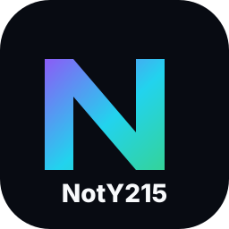

<!-- NotY215 profile README -->

<div align="center">


<p>
<a href="https://github.com/NotY215"></a>
<a href="https://github.com/NotY215"></a>
</p>

</div>

---

## $ whoami

I am **Shreyas Mishra**. My online name is **NotY215**, and I also go by **Fliczo** online.

I am an independent developer working on programming languages, compilers, systems, AI, media, games and developer tools.

Instagram: **@mishra_shreyas215**

I like going below the surface. If something is interesting, I want to understand how it works and eventually build my own version.

<div align="center">

</div>

### What I work on

All public repositories below are ranked by their current GitHub star counts. Star badges update automatically. Repositories with equal counts are grouped alphabetically.

| Rank | Repository | Stars | Focus |
|---:|---|---:|---|
| 1 | [PPSX33](https://github.com/NotY215/PPSX33) |  | PlayStation 3 full-recompilation research and runtime |
| 2 | [Vayu](https://github.com/NotY215/Vayu) |  | Programming language and integrated compiler/runtime |
| 3 | [AutoTotem](https://github.com/NotY215/AutoTotem) |  | Fabric client-side Minecraft utility mod |
| 4 | [AIFIAR](https://github.com/NotY215/AIFIAR) |  | Provider-aware AI engineering framework |
| 5 | [DXFS](https://github.com/NotY215/DXFS) |  | Digit-container format and terminal editor |
| 6 | [HeartsPlugin](https://github.com/NotY215/HeartsPlugin) |  | Minecraft health display and Vault balance plugin |
| 7 | [NotYCaptionGenAi-Light-weight](https://github.com/NotY215/NotYCaptionGenAi-Light-weight) |  | Whisper and Spleeter caption-generation CLI |
| 8 | [NotYGameRepacker](https://github.com/NotY215/NotYGameRepacker) |  | Native Windows game packaging system |
| 9 | [NotYUpscalerZAI](https://github.com/NotY215/NotYUpscalerZAI) |  | Desktop image and video enhancement tool |
| 10 | [NotyCaption-Official](https://github.com/NotY215/NotyCaption-Official) |  | Whisper, Colab and Drive caption workflow |
| 11 | [PPSX33-Web](https://github.com/NotY215/PPSX33-Web) |  | PPSX33 project website and technical wiki |
| 12 | [Vayu-Website](https://github.com/NotY215/Vayu-Website) |  | Vayu documentation and project website |
| 13 | [NotY215 profile](https://github.com/NotY215/NotY215) |  | Profile README and shared profile assets |

Only public repositories are included. Private, deleted, or unavailable repositories are excluded.
---

---

# 🚀 Main Projects

## 🌪️ Vayu

<div align="center">
<a href="https://vayu.gt.tc">

</a>
</div>

**Vayu** is my main programming-language project. It combines Python-inspired syntax with a statically typed language design, type inference, a growing standard library, editor tooling, and an integrated compiler/runtime architecture.

### Current implementation

The active compiler path is **VIB (Vayu Integration Backend)**, built into the Vayu project. Its current verified execution route is:

```text
.vyu source
    |
    v
Vayu frontend
    |
    v
Integrator lowering
    |
    v
VIR
    |
    v
VIR verifier
    |
    v
VIR interpreter
    |
    v
Program output and exit status
```

The implemented VIR subset includes arithmetic, strings and string methods, functions, return values, recursion, and basic control flow. The optional `.vye` package writer, reader, run path, Integrator dispatch, and content-addressed cache are marked complete in the roadmap.

**Native machine-code generation is still planned**, not complete. The current roadmap also tracks remaining interpreter/VM baseline repairs, branch-target verification, collections, modules, broader language support, measurement, ONNX, and release/self-host milestones.

### Tooling

- VS Code extension for `.vyu` files
- Visual Studio Community language support
- Vayu Language Server, formatter and linter
- `nva` package-manager tooling
- Syntax, architecture, package and AI/ML documentation

**Source:** [NotY215/Vayu](https://github.com/NotY215/Vayu)  
**Website:** [vayu.gt.tc](https://vayu.gt.tc)  
**Roadmap:** [Vayu Engineering Roadmap](https://github.com/NotY215/Vayu/blob/master/Roadmap.md)  
**VIB documentation:** [VIB Architecture](https://github.com/NotY215/Vayu/blob/master/docs/vib.md)  
**VS Code:** [Vayu Marketplace extension](https://marketplace.visualstudio.com/items?itemName=Fliczo.vayu)

---

---

## 🎮 PPSX33

<div align="center">
<a href="https://github.com/NotY215/PPSX33">

<br>

</a>
</div>

**PPSX33** is a Windows x64 PlayStation 3 full-recompilation research project. It loads decrypted ELF input, lifts supported PPU code into generated C++, links the host runtime, and works toward reproducing the PS3 services and hardware behavior required by games.

### Current codebase status

- Windows GUI, project workflow and build orchestration are present, with remaining gaps.
- ELF loading and PPU lifting are partial. Translation coverage does not prove semantic correctness.
- PPU runtime/control flow, LV2/PRX/NID services, SPU/MFC/DMA and SPURS are partial.
- Vulkan 1.2 is the default host graphics path. Swapchain presentation and guest RGBA upload are implemented baselines.
- RSX/GCM FIFO processing and assist/boot cmdstream drawing are partial. Title-authored rendering and shader behavior remain incomplete.
- Audio, input, filesystem and save-data paths have partial implementations.
- General game bootability and playability are not established.

The current roadmap prioritizes trustworthy PPU translation, guest runtime behavior, FIFO GET/PUT correctness, SPU behavior and title-authored RSX rendering. Diagnostic assists and static lift reports must not be presented as proof of working gameplay.

**Repository:** [NotY215/PPSX33](https://github.com/NotY215/PPSX33)  
**Website:** [ppsx33.xo.je](https://ppsx33.xo.je/)  
**Roadmap:** [PPSX33 ROADMAP.md](https://github.com/NotY215/PPSX33/blob/main/ROADMAP.md)  
**Architecture:** [Architecture guide](https://github.com/NotY215/PPSX33/blob/main/docs/ARCHITECTURE.md)

---

## 🌐 PPSX33-Web

**PPSX33-Web** is the canonical source for the PPSX33 website. It contains the homepage, About, Architecture, Wiki/Documentation, Roadmap, Updates, FAQ and Developer pages, along with shared CSS, JavaScript, TypeScript sources and site assets.

The website repository owns the page source and static assets. The host-side router is separate. The project website is a documentation and presentation layer; the PPSX33 repository remains the source of truth for implementation status.

**Repository:** [NotY215/PPSX33-Web](https://github.com/NotY215/PPSX33-Web)  
**Live website:** [ppsx33.xo.je](https://ppsx33.xo.je/)

---

# 🤖 AI & Media

| Project | Focus |
|---|---|
|  **NotYCaptionGenAi-Light-weight** | v7.1 modular Python CLI using Whisper and Spleeter, with word-level timestamps, chunked audio processing, translation, subtitle formatting, YouTube/local media support, Nuitka and PyInstaller build paths |
| **NotYUpscalerZAI** | AI-based video and image upscaling |
|  **NotyCaption-Official** | NotyCaption Pro with Whisper, Google Colab and Google Drive workflows |

**Caption Generator:** [Repository](https://github.com/NotY215/NotYCaptionGenAi-Light-weight)  
**Upscaler:** [Repository](https://github.com/NotY215/NotYUpscalerZAI)  
**NotyCaption Pro:** [Repository](https://github.com/NotY215/NotyCaption-Official)  
**NotyCaption Website:** [notycaptiongen.free.nf](https://notycaptiongen.free.nf)

### 🧠 AIFIAR

<div align="center">
<a href="https://github.com/NotY215/AIFIAR">

</a>
</div>

**AIFIAR** (Artificial Intelligence Framework for Interpretation and Reasoning) is an early-stage, provider-aware framework for disciplined AI-assisted software engineering. Its TypeScript workflow modules cover requirement tracking, repository context, planning, model routing, task scheduling, patch proposals, approval boundaries, transaction journaling and verification. Python tooling provides repository scanning, safety checks, patch validation and bounded command workflows, with an optional Docker runner.

Provider adapters include OpenAI Chat Completions and Responses, xAI, Anthropic, Gemini, Qwen/Qwen Code, and explicitly configured local or self-hosted OpenAI-compatible endpoints. The project includes language/provider instruction packs and durable repository memory. It is not yet a complete autonomous coding agent: authenticated approval UI, native Windows race-resistant file operations, production-grade host isolation and several deployment validation gates remain incomplete.

**Repository:** [NotY215/AIFIAR](https://github.com/NotY215/AIFIAR)

---

# 🎮 Game & Minecraft

### 📦 NotYGameRepacker

<div align="center">
<a href="https://github.com/NotY215/NotYGameRepacker">

</a>
</div>

A Windows-first game packaging and installation project for files the user legitimately owns.

The current foundation uses C++20, C17, the Windows SDK, native Win32 UI, CMake and MSVC. It is designed around a versioned `.noty` package format, manifest generation, chunked processing, a generated Setup application and installation verification. The native Windows foundation and build architecture are present, but the complete package/repack/install pipeline is still in development. Cryptography is not implemented, so the project does not claim to provide encryption or authenticated package security.

[Repository](https://github.com/NotY215/NotYGameRepacker)

### 🛡️ AutoTotem

<div align="center">
<a href="https://github.com/NotY215/AutoTotem">

</a>
</div>

A lightweight Fabric client-side Minecraft mod that moves a Totem of Undying into the off-hand at a low health threshold and returns it to its original slot after recovery. It has a toggle keybind and separate builds for Minecraft 1.21.9–1.21.11 and 26.1.x–26.3, using the appropriate Yarn or Mojang mappings.

[Repository](https://github.com/NotY215/AutoTotem)

### ❤️ HeartsPlugin

A lightweight Minecraft plugin with heart-based HP indicators and Vault integration for displaying player balances below the health bar.

[Repository](https://github.com/NotY215/HeartsPlugin)

---

# 🧪 DXFS

**DXFS** is a C++17 digit-container file format and terminal editor. It supports packed decimal storage and generator-based representations such as repeating patterns and known constants. Its design distinguishes genuine compression from compact recipes that regenerate predictable digit sequences; arbitrary random digits remain bounded by their information content. The project provides `dxtool` for packing, unpacking, generation and validation, plus a POSIX full-screen editor.

[Repository](https://github.com/NotY215/DXFS)

---

# 🌐 Websites

| Project | Website |
|---|---|
| **Vayu** | [vayu.gt.tc](https://vayu.gt.tc) |

| **NotyCaption Pro** | [notycaptiongen.free.nf](https://notycaptiongen.free.nf) |

The Vayu website is the main place for current language information, documentation, roadmap and benchmark information. The PPSX33 website has its own source repository and technical wiki.

---

---

# 🧰 Stack

<div align="center">


</div>

**Languages:** C++ • C • Python • Java • Vayu • x86-64 Assembly  
**Systems:** CMake • Ninja • LLVM • Clang • Git  
**AI & Media:** Whisper • Spleeter • FFmpeg • Nuitka • PyInstaller  
**Application & Game:** Qt • Fabric • Minecraft • OpenGL • Windows

---

# 🎯 Current Goals

### Vayu

Expand the verified VIB/VIR language subset, complete the remaining baseline repairs, and progress through verifier hardening, collections, modules and later native code generation milestones.

### PPSX33

Continue PPU translation trust, guest runtime and HLE correctness, SPU/MFC/DMA behavior, and title-authored RSX/GCM rendering. Keep all compatibility claims tied to end-to-end evidence.

### Keep building

I learn by making things, breaking them, fixing them and trying again.

---

---

# 📊 GitHub

<div align="center">


<br>


<br>


</div>

---

# htop Activity

```text
 NotY215 activity monitor
 ─────────────────────────────────────────────────────────

 PID   PROJECT              STATE
 001   Vayu                 BUILDING
 002   PPSX33               RECOMPILER DEVELOPMENT
 003   AIFIAR               ACTIVE
 004   NotY Caption         ACTIVE
 005   NotYGameRepacker     FOUNDATION
 006   AutoTotem            ACTIVE
 007   DXFS                 EXPERIMENT
 008   PPSX33-Web           WEBSITE

 STATUS  : building
 FOCUS   : languages • compilers • AI workflows • systems • tools
```

---

---

# 🧭 Current Direction

```text
Vayu
 │
 ├── Frontend
 │    ├── Lexer / Parser
 │    ├── Semantic Analysis
 │    └── Integrator Lowering
 │
 ├── VIB
 │    ├── VIR
 │    ├── VIR Verifier
 │    ├── VIR Interpreter
 │    └── .vye Package Track
 │
 └── Ecosystem
      ├── Language Server
      ├── Formatter / Linter
      ├── Package Tooling
      └── Native Codegen (planned)

PPSX33
 │
 ├── ELF Loading / PPU Lifting
 ├── Guest Runtime / HLE
 ├── SPU / MFC / DMA
 └── RSX / GCM / Vulkan 1.2
```

---

---

# 🎨 Outside Code

I also spend time on:

- 🎬 Video editing
- 🎞️ Anime edits
- 🖼️ Visual design
- 🎮 Gaming
- 🧩 Game development
- 🧪 Technical experimentation

Creative work and programming often overlap in the same projects.

---

# 📚 How I Learn

I learn by building.

```text
Question
   ↓
Research
   ↓
Prototype
   ↓
Break it
   ↓
Understand why
   ↓
Rebuild it
   ↓
Keep going
```

---

# 🔭 Long-Term

The bigger direction is an ecosystem where the pieces connect:

```text
Language
   ↓
Compiler
   ↓
Backend
   ↓
Runtime
   ↓
Tools
   ↓
Applications
   ↓
Systems
```

Vayu is the center of that direction. The other projects let me explore different layers of software engineering.

---

# 🔗 Find Me

<div align="center">

[GitHub](https://github.com/NotY215) • [Vayu](https://vayu.gt.tc) • [Modrinth](https://modrinth.com/user/NotY215) • [Instagram](https://www.instagram.com/mishra_shreyas215/) • [Telegram](https://t.me/Noty_215) • [YouTube: NotY215](https://www.youtube.com/@NotY215) • [YouTube: Aayush Crossing](https://www.youtube.com/@AayushCrossing)

<br><br>


<br>



### NotY215

**Independent developer • Editor • Gamer • Programmer • Game developer**

</div>

## Project policies

- [Contributing](CONTRIBUTING.md)
- [Code of Conduct](CODE_OF_CONDUCT.md)
- [Security](SECURITY.md)
- [Support](SUPPORT.md)
- [Citation](CITATION.cff)
- [Governance](GOVERNANCE.md)
- [License](LICENSE)
